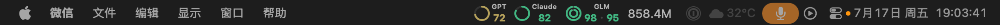
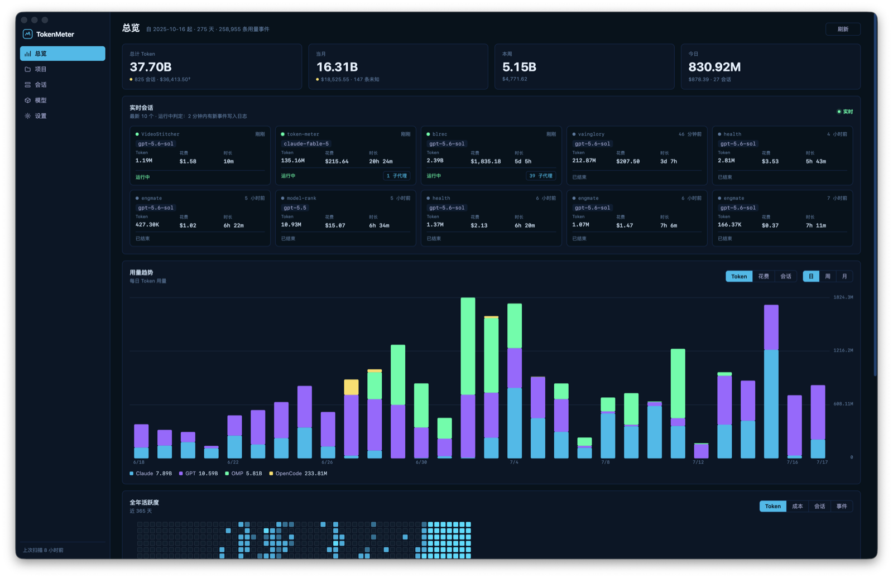
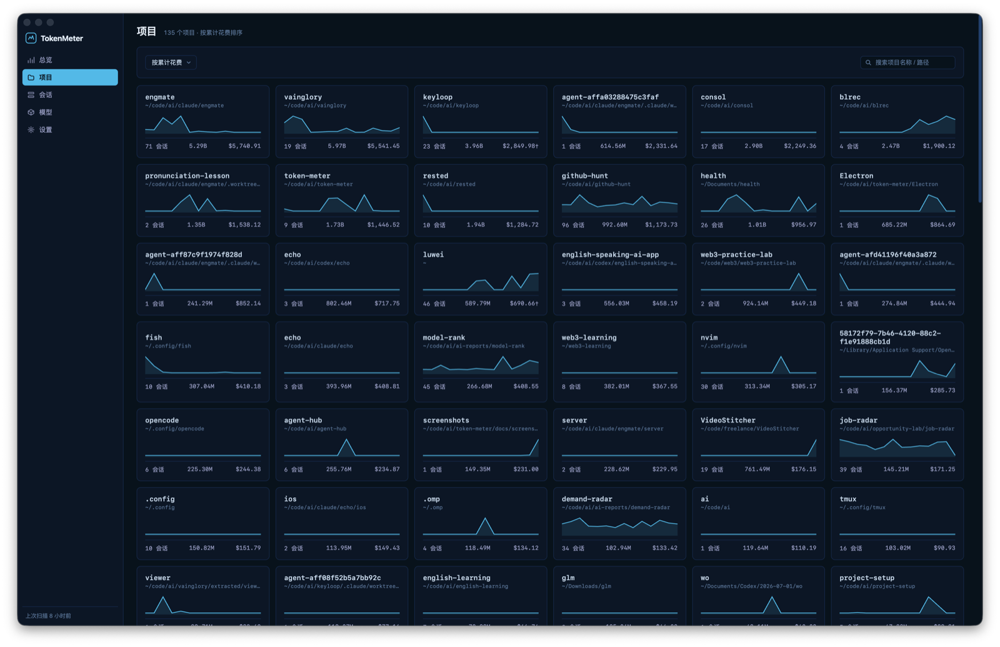
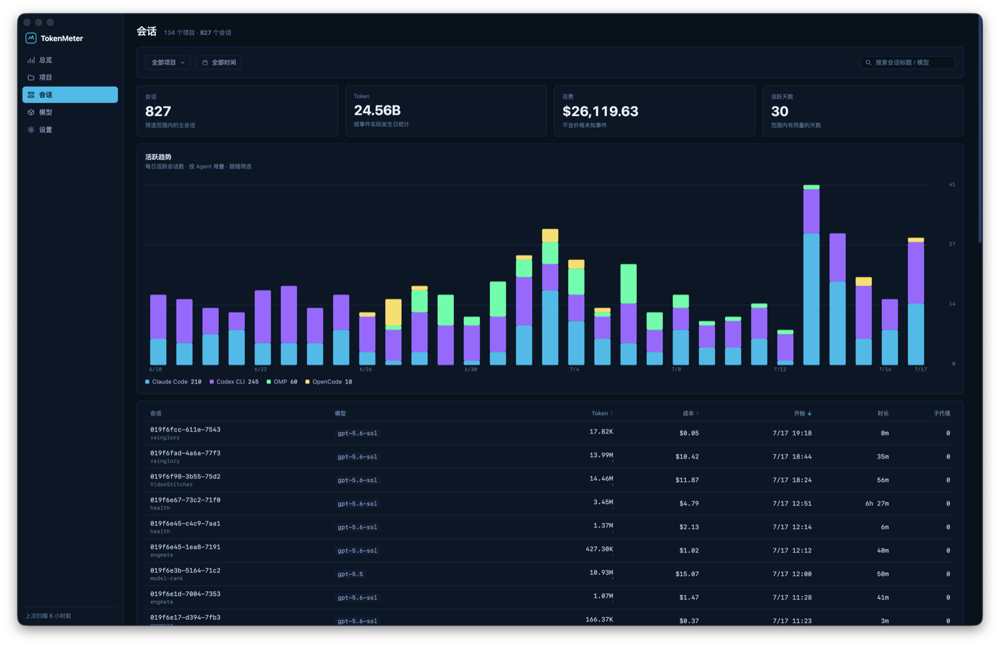
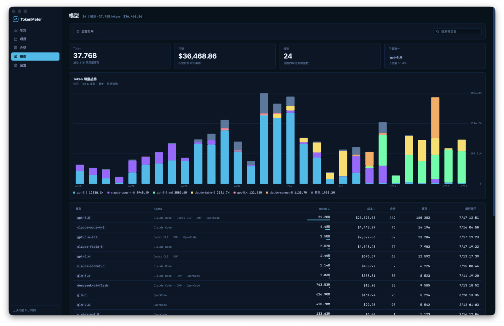
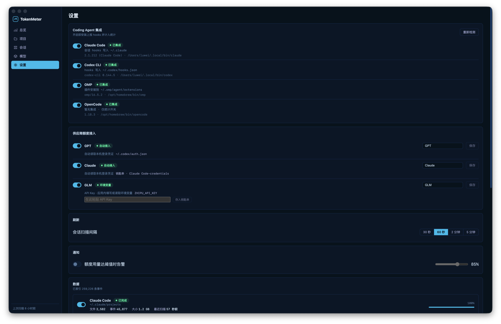
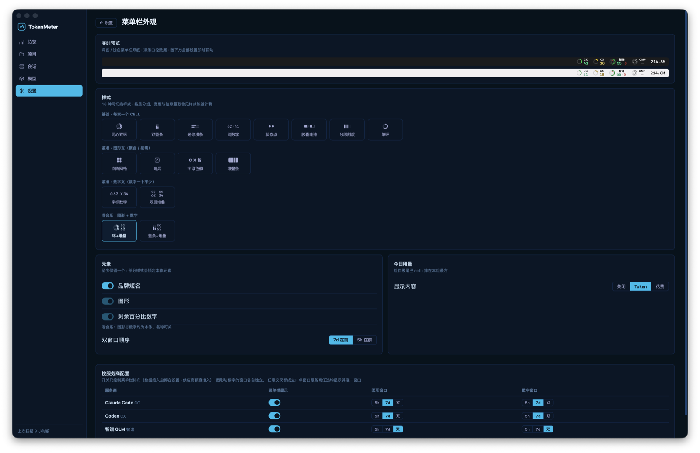

# TokenMeter

English | [简体中文](README.md)

**A coding-agent usage dashboard that lives in your macOS menu bar** — real-time token usage, spend, and subscription quota tracking for Claude Code, Codex CLI, and friends. Fully local, nothing ever uploaded.



## Why

Heavy coding-agent users ask the same three questions every day: **How many tokens did I burn today? How much of this week's quota is left? Which model is eating my money?** TokenMeter keeps the answers one glance away — quota rings in the menu bar, a full dashboard one click below.

Codex reset cards show the remaining days, hours, or minutes. An opt-in setting can use a selected card within one hour of expiry, with duplicate-redemption protection. It is off by default and requires the menu bar app to be running and online. See the [reset-card contract](docs/codex-reset-credit-automation.md).

## Features

### Menu bar

- **Account balances** appear beside the provider name when the provider confirms available credits or prepaid funds. The macOS menu bar shows Codex plan quota first, then available credits when a primary window runs out, and 0 when both are exhausted. Hover over Codex credits to see the full precision. Claude Code shows prepaid funds in the account currency and expands to show reported monthly extra spend and its cap. Hover over a quota warning to see which window is affected, a provider error, or the age of the data.

- **Multi-provider subscription quotas**: remaining % for 5-hour / 7-day windows, with pace-aware alert colors (green = healthy, yellow = burning fast, red = exhausted)
- **Prompt cache hit rate** is shown for each summary period, for today’s models and in calendar day details. Hover over a summary card to see exact token counts. [Metric definition](docs/month-heatmap.md)
- **16 switchable styles**: concentric rings, bars, capsules, dot grid, sentinel, stacked deck… swap whenever you're bored
- **Deep customization**: toggle brand name / glyph / numbers independently, per-provider window selection, today-usage tail (tokens / cost / off)
- **Quota alerts**: system notification when usage crosses your threshold
- **One-click self-update**: download, SHA-256 verify, atomic swap, and relaunch in one go (the existing install is never touched unless every check passes)

### Main window (Electron)

| Overview | Projects |
|---|---|
|  |  |

| Sessions | Models |
|---|---|
|  |  |

- **Overview**: all-time / month / week / today KPIs, live session cards (second-level state via hooks), usage trend histogram, year heatmap
- **Projects**: aggregated by working directory, spend sparklines and model distribution
- **Sessions**: main-session list (subagents merged in), trend and stat cards follow filters, drill into subagent tasks
- **Models**: per-model token / cost ranking, Top-6 model usage trend
- **Settings**: local agent-source toggles, provider quota access, live menu-bar preview

| Settings | Menu bar customization |
|---|---|
|  |  |

## Supported sources

**Local session accounting** (parses logs the agents already write, read-only):

| Agent | Source | Additional accounting |
|---|---|---|
| Claude Code | `~/.claude/projects/*.jsonl` | — |
| Codex CLI | `~/.codex/sessions/*.jsonl` | — |
| OMP (Oh My Pi) | `~/.omp/agent/sessions/*.jsonl` | — |
| OpenCode | `~/.local/share/opencode/opencode.db` | — |
| Grok Build | `$GROK_HOME/sessions/*/*/updates.jsonl` (default `~/.grok/sessions`) | — |
| Qwen Code | sessions/monthly ledger under `QWEN_RUNTIME_DIR` + `QWEN_HOME/usage_record.jsonl` (both default to `~/.qwen`) | Tokens |
| Qoder CLI / Desktop | `~/.qoder-cn/projects/**/*.jsonl`; Desktop attribution from `main.sqlite` | Tokens when the source actually reports them; per-request Credits; official CLI model names. Current Qwen3.8-Max data has positive Credits but zeroed Token counters, so Token is shown as unreported and is never inferred |
| Antigravity CLI | `~/.gemini/antigravity-cli/conversations/*.db` | Per-generation tokens, cache usage, reasoning, and estimated model cost |
| Gemini CLI | JSON and JSONL recordings under `~/.gemini/tmp/*/chats/` | Historical and subagent tokens, cache usage, and estimated model cost |
| Tencent WorkBuddy | `~/.workbuddy/projects/**/*.jsonl` + `~/.workbuddy/workbuddy.db` | Tokens, Credits, locally estimated cost; runtime corpus still pending |

Doubao Work is not integrated because no token/cost ledger could be validated reliably. See the [local data-source contract and evidence](docs/data-source-contracts.md) for field semantics, precedence, deduplication, and validation boundaries.

**Subscription quotas** (uses credentials already on your machine, or an API key):

| Provider | Credential source |
|---|---|
| Claude Code | Keychain (local login) |
| Codex | `~/.codex/auth.json` |
| Antigravity (AGY) | Enable in Settings to refresh quota automatically using the signed-in CLI. Expand the card for Gemini, Claude/GPT, and model-specific limits. [Setup and quota rules](docs/antigravity-quota.md) |
| Zhipu GLM | In-app key (stored in Keychain) or `ZHIPU_API_KEY` |
| OpenCode Go | In-app "Sign in with OpenCode Go" (WebView login, valid 1 year) |
| Grok Build | `~/.grok/auth.json` (`grok login`) |
| Qoder | Existing Qoder CLI login; Plan, Add-on, and shared organization Credits through the official `get_usage_info` control API |

## Architecture

```
┌─ Menu bar app (Swift / AppKit + SwiftUI)
│   ├─ Incremental log scanning → derived SQLite DB (safe to delete anytime)
│   ├─ Hooks-based live reporting (session start/heartbeat/stop)
│   ├─ Quota API polling (≥5 min, rate-limit friendly)
│   └─ Unix socket IPC
└─ Main window (Electron + React)
    └─ Reads the same SQLite, event-driven refresh
```

- **Cost**: a daily GitHub Action generates and validates the LiteLLM pricing snapshot; the app checks the checksum hourly and downloads and atomically replaces the cache when prices change and falls back to its previous or bundled snapshot on failure. Local calculations support multiple context-length price tiers and preserve unknown prices; see the [pricing contract](docs/pricing.md)
- **One source of truth**: menu bar "today", popover, and every main-window page all derive from the same message-level event table (`usage_events`)

## Install

Build from source for now (macOS 13+, Xcode command line tools, Node.js LTS):

```bash
git clone https://github.com/luweiCN/token-meter.git
cd token-meter
./scripts/install-app.sh
```

The script builds a release binary, installs `/Applications/TokenMeter.app`, and registers login autostart. After first launch, enable the agents you use under Settings → Coding Agent Integration.

Dev mode (renderer hot reload):

```bash
./scripts/dev-app.sh
```

## Verify

```bash
swift test                                  # Swift unit tests
npm test --prefix Electron                  # Electron unit tests
python3 -m unittest discover -s scripts -p 'test_*.py'   # pricing transform tests
scripts/reconcile-with-ccusage.sh           # independent reconciliation vs ccusage (read-only)
```

## Privacy

- **Fully local**: no accounts, no telemetry, nothing uploaded
- **Read-only sources**: agent session logs are never written to or modified; the derived DB can be deleted and rebuilt at any time
- **Metadata only**: token counts, model names, timestamps — prompts and responses never enter the database

## License

[MIT](LICENSE)
