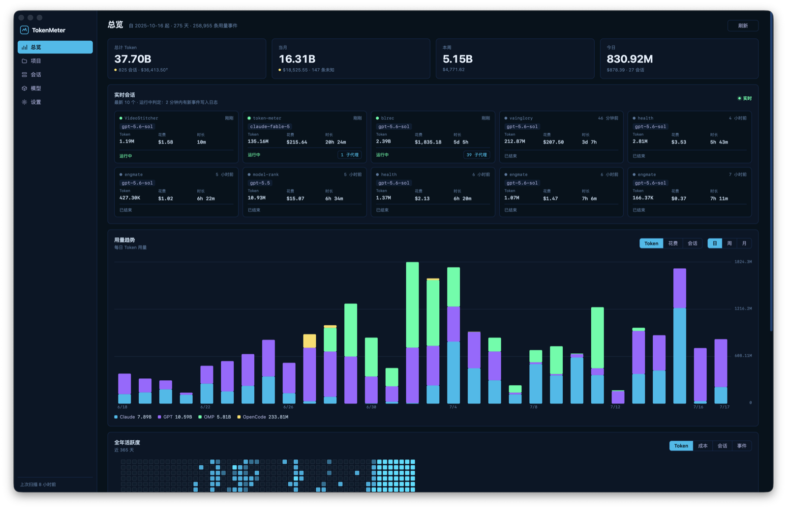
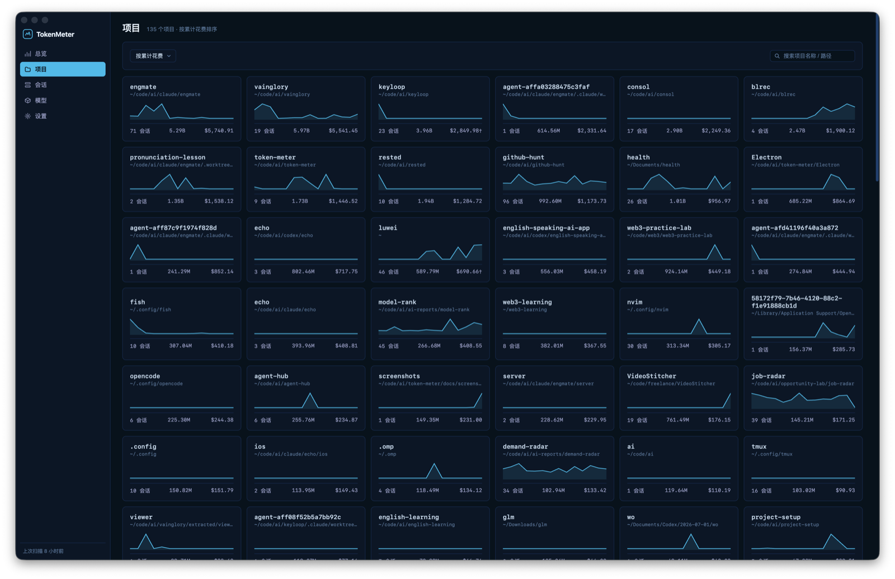
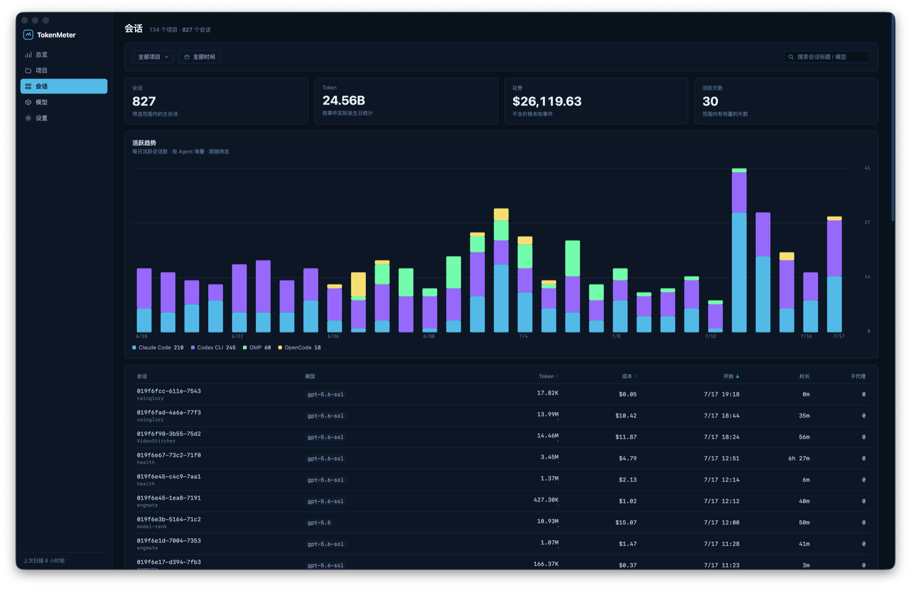
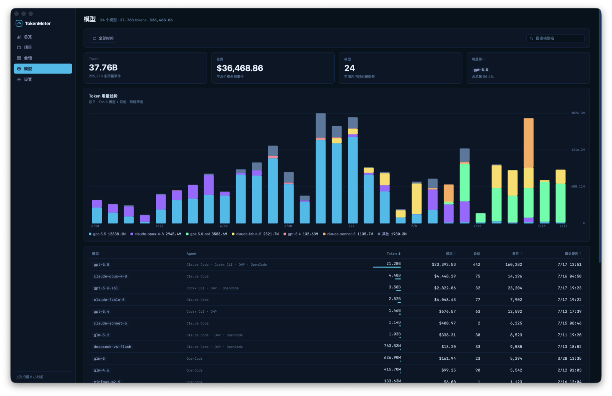
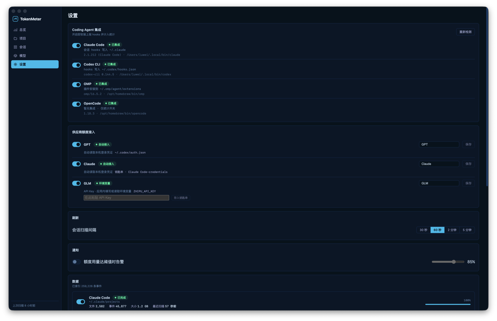
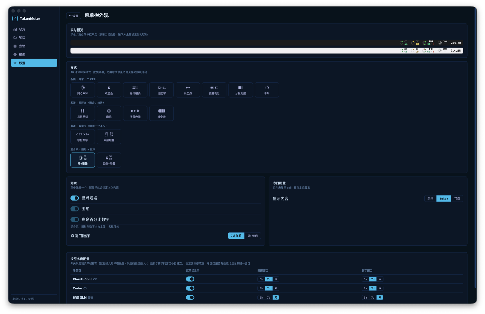

# TokenMeter

[English](README.en.md) | 简体中文

**macOS 菜单栏里的 coding agent 用量仪表盘** —— 实时统计 Claude Code、Codex CLI 等本地 AI 编程工具的 token 用量、花费与订阅额度。跨设备同步由用户配对后开启。


## 它解决什么问题

重度使用 coding agent 的人每天都在问三个问题：**今天烧了多少 token？这周额度还剩多少？钱都花在哪个模型上了？** TokenMeter 把答案常驻在菜单栏——额度环一眼看余量，点开是完整仪表盘。

## 功能

### 菜单栏常驻

- **账户余额**在供应商确认有可用积分或预付款时显示在名称旁，收起卡片也可见。macOS 顶栏优先显示 Codex 套餐额度，主窗口额度用尽后显示可用积分，两者均用尽时显示 0。悬停 Codex 积分可查看完整精度。Claude Code 按账户币种显示预付款，展开可查看本月额外用量和支出上限。悬停账户额度的感叹号可查看对应窗口的额度提醒、供应商报错或上次更新时间。

- **多供应商订阅额度**：5 小时 / 7 天 / 月度窗口剩余百分比，时间进度感知的警戒色（绿=充裕、黄=消耗偏快、红=用尽）
- **缓存命中率**可在总计、本月、本周、今日模型及日历日期详情中查看。悬停统计卡可查看精确 Token 数和缓存读入明细。[统计口径](docs/month-heatmap.md)
- **16 种可切换样式**：同心双环、竖条、胶囊电池、点阵、哨兵、双层堆叠……看腻了随时换
- **深度定制**：品牌名 / 图形 / 数字逐项开关，每家供应商独立配置显示窗口，今日用量尾巴三态（Token / 花费 / 关闭）
- **Codex 重置卡**：统一显示剩余天数、小时或分钟；可在 Codex 设置中开启到期前 1 小时自动使用，默认关闭，支持指定卡片和防重复消费。规则见[重置卡自动使用](docs/codex-reset-credit-automation.md)。
- **额度告警**：用量达到阈值时系统通知
- **一键自动更新**：发现新版后下载、SHA-256 校验、原子替换、自动重启一气呵成（校验不过绝不动现有安装）

### 主界面（Electron）

| 总览 | 项目 |
|---|---|
|  |  |

| 会话 | 模型 |
|---|---|
|  |  |

- **总览**：累计 / 当月 / 本周 / 今日 KPI、实时会话卡（hooks 秒级状态）、用量趋势直方图、全年活跃度热力图
- **项目**：按工作目录聚合，花费火花线与模型分布
- **会话**：主会话列表（子代理自动归并），活跃趋势与统计卡跟随筛选，下钻子代理任务明细
- **模型**：按模型聚合的 token / 成本排行，Top 6 模型用量趋势
- **设置**：agent 本地数据源开关、供应商额度接入、菜单栏外观实时预览

| 设置 | 菜单栏外观定制 |
|---|---|
|  |  |

## 支持的数据源

**本地会话统计**（解析 agent 自己写盘的日志，只读）：

| Agent | 数据源 | 额外用量 |
|---|---|---|
| Claude Code | `~/.claude/projects/*.jsonl` | — |
| Codex CLI | `~/.codex/sessions/*.jsonl` | — |
| OMP (Oh My Pi) | `~/.omp/agent/sessions/*.jsonl` | — |
| OpenCode | `~/.local/share/opencode/opencode.db` | — |
| Grok Build | `$GROK_HOME/sessions/*/*/updates.jsonl`（默认 `~/.grok/sessions`） | — |
| 千问 Code | `QWEN_RUNTIME_DIR` 下的会话/月度账本 + `QWEN_HOME/usage_record.jsonl`（均默认 `~/.qwen`） | Token |
| Qoder CLI / Desktop | `~/.qoder-cn/projects/**/*.jsonl`；Desktop 用 `main.sqlite` 判定归属 | 来源实际提供时统计 Token；逐请求 Credits；模型展示名来自 CLI 官方模型目录。当前 Qwen3.8-Max 实测只给正数 Credits、Token 计数器全零，界面明确标为未上报，不做换算 |
| Antigravity CLI | `~/.gemini/antigravity-cli/conversations/*.db` | 每次生成的 Token、缓存、推理和按模型估算的费用 |
| Gemini CLI | `~/.gemini/tmp/*/chats/` 下的 JSON 和 JSONL | 历史会话与子代理的 Token、缓存和按模型估算的费用 |
| 腾讯云 WorkBuddy | `~/.workbuddy/projects/**/*.jsonl` + `~/.workbuddy/workbuddy.db` | Token、Credits、本地估算成本；真实运行数据待复核 |

豆包工作尚未发现可可靠验证的 Token / 成本账本，因此没有伪造接入。各来源的字段、优先级、去重规则和验证边界见[本地数据源契约](docs/data-source-contracts.md)。

**订阅额度**（读取本机已登录凭证或 API Key）：

| 供应商 | 凭证来源 |
|---|---|
| Claude Code | 钥匙串（本机登录态） |
| Codex | `~/.codex/auth.json` |
| Antigravity（AGY） | 在设置中开启后，用已登录的 CLI 自动查询额度。展开可查看 Gemini、Claude/GPT 和模型专属窗口。[使用与额度规则](docs/antigravity-quota.md) |
| 智谱 GLM | 应用内填写（存钥匙串）或 `ZHIPU_API_KEY` |
| OpenCode Go | 在设置中登录 OpenCode 账户，或使用 Go API Key |
| Command Code | 应用内填写 Studio API Key（存钥匙串）、`COMMAND_CODE_API_KEY` 或 `~/.commandcode/auth.json`；无需安装 CLI |
| Grok Build | `~/.grok/auth.json`（`grok login`） |
| Qoder | 本机 Qoder CLI 登录态；通过官方 `get_usage_info` 控制接口读取套餐、加购与组织共享 Credits |

## 架构

跨平台 CLI 常驻采集账户额度、读取 OpenClaw 与 Hermes 的本机会话，并向已配对的设备提供签名汇总。Mac 上的其他 Agent 会话继续由随包的索引器写入本机 SQLite。SwiftUI 菜单栏从 CLI 发布的快照显示额度，手动刷新也交给 CLI。Electron 使用本机账本显示明细，并通过 CLI 查询和管理设备。

- **成本计算**：GitHub Action 每日从 LiteLLM 生成并校验定价快照；应用每小时核对校验和，价格变化时下载并原子替换缓存，失败时继续使用旧缓存或随包快照。支持按请求输入长度选择多档价格，缺失价格明确记为未知，详见[定价契约](docs/pricing.md)
- **多设备统计**：菜单栏和弹窗使用已同步的设备汇总。[统计口径](docs/device-sync.md)

## 命令行与多机同步

Mac、Linux、Windows 可运行同一个命令行服务，采集 OpenClaw 和 Hermes Agent，在主界面「设备 → 添加设备」创建邀请，另一台可粘贴链接、输入配对码，或在兼容客户端扫码。配对支持不同网络。菜单栏按当天用量显示机器、Agent、费用和缓存命中率，两台及以上有用量才显示机器栏。安装、自启、自动更新和配对步骤见[设备与命令行](docs/device-sync.md)。

## 安装

从 [GitHub Releases](https://github.com/luweiCN/token-meter/releases) 下载与你的 Mac 架构匹配的 ZIP，解压后把 TokenMeter 拖入「应用程序」。`arm64` 对应 Apple Silicon。命令行安装见[设备与命令行](docs/device-sync.md)。

从源码构建需要 macOS 13+、带 macOS 15 或更新 SDK 的 Xcode、Node.js LTS，以及 `go.mod` 指定的 Go。

```bash
git clone https://github.com/luweiCN/token-meter.git
cd token-meter
./scripts/install-app.sh
```

脚本会完成 release 构建、安装到 `/Applications/TokenMeter.app` 并注册登录自启。首次启动后在 设置 → Coding Agent 集成 里打开你在用的 agent 即可。

开发模式（renderer 热更新）：

```bash
./scripts/dev-app.sh
```

## 开发验证

```bash
swift test                                  # Swift 单元测试
npm test --prefix Electron                  # Electron 单元测试
python3 -m unittest discover -s scripts -p 'test_*.py'   # 定价转换测试
scripts/reconcile-with-ccusage.sh           # 与 ccusage 独立对账（全程只读）
```

## 隐私

- 限额查询使用本机登录态。配对的设备以端到端加密连接交换用量汇总。登录凭据和对话保存在来源设备。
- **只读数据源**：绝不写入、修改 agent 的会话日志；派生数据库删除即重建
- **只统计元数据**：token 数、模型名、时间戳——提示词与回复正文从不入库

## License

[MIT](LICENSE)
